# Screen Specifications & Information Architecture
## AI Smart Study Planner

**Version:** 1.0.0  
**Target Viewports:** Desktop (1440x900, 1920x1080), Tablet (768x1024), Mobile (375x812, 393x852)

---

## 1. Screen Architecture & Routes Overview

```mermaid
graph TD
    AppRoot["/ (Root Layout)"] --> Auth["/login & /register"]
    AppRoot --> Onboarding["/onboarding (10-Step Setup)"]
    AppRoot --> Dashboard["/dashboard (Main Control Center)"]
    AppRoot --> Subjects["/subjects (Curriculum & Units)"]
    AppRoot --> Planner["/planner (Calendar & Agenda)"]
    AppRoot --> Session["/session/:id (Active Study Workspace)"]
    AppRoot --> AITutor["/ai (Conversational Assistant)"]
    AppRoot --> Revision["/revision (Spaced Repetition Hub)"]
    AppRoot --> Quizzes["/quizzes (Assessment Center)"]
    AppRoot --> Universe["/universe (3D Study Galaxy)"]
    AppRoot --> Rewards["/rewards (Gamification & Badges)"]
    AppRoot --> Settings["/settings (Preferences & Profile)"]
```

---

## 2. Key Screen Specifications

### 2.1 Dashboard (`/dashboard`)
- **Top Bar:** Greeting with student name, localized date, current streak flame badge, and Quick-Start Session CTA.
- **Hero Module:** *"Today's Focus"* showing the immediate scheduled session with one-click "Begin Focus Timer" and exam countdown badge (`Operating Systems Final in 14 days`).
- **Metrics Grid (4 Columns):**
  1. *Daily Progress:* Circular ring showing completed minutes vs daily goal (e.g. `90 / 180 min`).
  2. *Syllabus Completion:* Percentage bar across all subjects.
  3. *Revision Due:* Badge with count of due flashcards (`4 Due Today`).
  4. *Academic Level & XP:* Level badge with current XP and progress to next level.
- **Main Area (2 Columns, 8:4 split):**
  - Left: *Today's Agenda Timeline* listing all planned sessions, breaks, and status tags.
  - Right: *Needs Attention Module* displaying the 3 lowest-scoring topics with direct "Review Now" actions.

### 2.2 Study Plan & Calendar (`/planner`)
- **Header:** View mode switcher (`Day`, `Week`, `Month`), date navigator (`< Today >`), and "Regenerate / Rebalance Plan" button.
- **Weekly Schedule Grid:** 7 columns showing time slots from 07:00 to 22:00.
- **Session Blocks:** Draggable blocks color-coded by subject, with start time, topic title, and duration badge.
- **Conflict & Overload Banner:** Informs student if a day exceeds maximum study hours.

### 2.3 Active Study Session Workspace (`/session/:id`)
- **Focused Top Header:** Subject breadcrumb, topic title, session type (`LEARN` or `REVISE`), and "Distraction-Free Mode" toggle.
- **Central Focus Timer:** Large tabular-numeral countdown clock (`44:59`), Start/Pause button, +5 min extension button, and Finish Early button.
- **Right Context Drawer:**
  - Tab 1: *Checklist* (Objectives to mark off during study).
  - Tab 2: *Quick Notes* (Autosaving Markdown notepad for this topic).
  - Tab 3: *Ask AI* (Contextual AI question drawer focused on this topic).
- **Session Completion Modal:** Prompt for reflection confidence rating (1–5 stars), records actual duration, and triggers XP celebration.

### 2.4 AI Study Assistant (`/ai`)
- **Left Sidebar:** Conversation history categorized by "Today", "Previous 7 Days", and "By Subject", with "New Chat" button.
- **Active Chat View:**
  - Header: Subject & Topic picker dropdowns (injects syllabus context).
  - Format Selector: Scrollable pill bar featuring all 16 formats (e.g. `2-Mark`, `5-Mark`, `Simple`, `Code`, `Derivation`).
  - Message Stream: Markdown messages with syntax highlighting, copy, save note, and quiz generation buttons.
  - Composer: Multi-line auto-expanding textarea with Send button, keyboard shortcut hint (`Cmd/Ctrl + Enter`), and cancel stream button.

### 2.5 3D Study Universe (`/universe`)
- **Canvas View:** WebGL full-bleed canvas rendering the interactive planetary system.
- **Floating HUD:**
  - Subject filter toggle (isolate single subject or view all).
  - Mastery color legend.
  - "Switch to 2D Tree View" button for low-power devices.
- **Node Drawer:** Appears on clicking any planetary topic, displaying syllabus depth, mastery score, last studied date, and quick action buttons.
