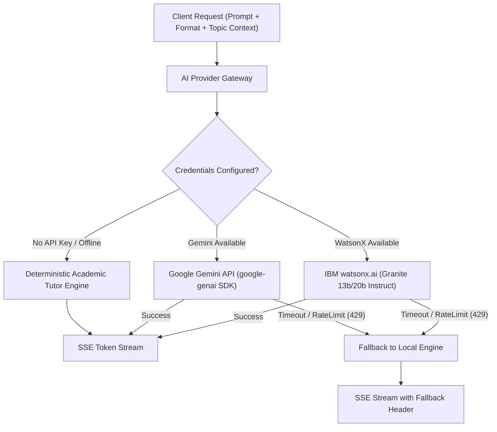

# AI Provider Integration & Learning Assistant Architecture
## AI Smart Study Planner

**Version:** 1.0.0  
**Primary Integration:** IBM watsonx / IBM Granite Academic Models  
**Secondary Provider:** Google Gemini API (`gemini-1.5-flash` / `gemini-2.0-flash`)  
**Offline / Local Fallback:** Verified Academic Curriculum Engine (Deterministic Academic Knowledge Base)

---

## 1. Provider Gateway Architecture

To protect user stability and guarantee that students can continue studying even during LLM API outages or missing environment variables, all AI interactions route through an abstract gateway:



### Key Rules:
1. **Never Invent Verification:** If no external provider API key is supplied in `.env`, the system explicitly flags responses as `[Demo Tutor / Verified Curriculum]` rather than pretending to reach an external LLM.
2. **Zero Client Secret Leakage:** All API keys (`WATSONX_APIKEY`, `GEMINI_API_KEY`, etc.) remain strictly on the backend Node.js server.
3. **Structured Validation:** All generated quizzes, flashcards, and exam notes are passed through Zod schemas before being saved or returned to the client.

---

## 2. The 16 Discrete Answer Formats & System Prompts

The user's selected `formatType` drastically alters the system instructions and structural constraints.

| Format Identifier | Structural Goal | Key System Instruction Additions |
| :--- | :--- | :--- |
| `EXPLAIN` | Balanced concept breakdown | "Explain the fundamental mechanism, purpose, and real-world significance." |
| `SIMPLE` | ELI5 / Analogies | "Explain using intuitive everyday analogies; eliminate dense jargon; focus on conceptual clarity." |
| `DETAILED` | Comprehensive treatise | "Provide deep theoretical rigor, historical genesis, architectural diagrams (in ASCII/mermaid), and trade-offs." |
| `STEP_BY_STEP` | Algorithmic or procedural steps | "Deconstruct into numbered, discrete sequential steps with input-to-output progressions." |
| `EXAM_2M` | University 2-Mark Question | "Provide an exact, high-yield university exam definition in 2 to 3 concise sentences with 1 key keyword highlighted." |
| `EXAM_5M` | University 5-Mark Question | "Format as: 1. Core Definition (1m), 2. Working Principle / 3 Key Points (3m), 3. Labeled Diagram description / Example (1m)." |
| `EXAM_10M` | University 10-Mark Question | "Produce a structured academic answer: Introduction, Detailed Architecture, In-Depth Working, Advantages/Disadvantages, and Concrete Industrial Application." |
| `EXAM_12M` | University 12-Mark Question | "Provide deep analytical depth, mathematical formulations, comparative analysis, and edge cases." |
| `EXAM_15M` | University 15-Mark Master Thesis | "Exhaustive university exam paper answer: Genesis, Theoretical Framework, Mathematical Proofs, Real-World Implementations, Limitations, and Future Directions." |
| `SHORT_NOTES` | Quick revision cheat sheet | "Provide punchy bullet points, bolded key terms, equations, and common examination pitfalls." |
| `BULLET_POINTS` | Concise bulleted summary | "Provide exactly 6 to 10 high-yield standalone factual bullet points." |
| `TABLE` | Comparative matrix | "Format strictly as a Markdown table comparing attributes, time complexities, use cases, and trade-offs." |
| `CODE` | Practical code walkthrough | "Provide clean, commented code (e.g. Python/C++/JS) accompanied by step-by-step trace and Big-O Time/Space Complexity analysis." |
| `MATH_DERIVATION` | Formal mathematical proof | "Provide step-by-step algebraic/calculus derivation using clean LaTeX notation ($...$ and $$...$$)." |
| `FLASHCARDS` | Active recall deck | "Output JSON array of Front (Question) and Back (Concise Answer) items." |
| `QUIZ` | Multiple choice assessment | "Output JSON formatted questions with options A, B, C, D, correctAnswer, and comprehensive educational explanation." |

---

## 3. Server-Sent Events (SSE) Protocol

Streaming is implemented using native Node.js HTTP response streaming:

```javascript
// Express route handler
app.post('/api/v1/ai/stream', async (req, res) => {
  res.setHeader('Content-Type', 'text/event-stream');
  res.setHeader('Cache-Control', 'no-cache, no-transform');
  res.setHeader('Connection', 'keep-alive');
  res.flushHeaders();

  const { conversationId, prompt, formatType, topicId } = req.body;
  
  try {
    const stream = await aiGateway.streamResponse({ prompt, formatType, topicId });
    for await (const chunk of stream) {
      res.write(`event: delta\ndata: ${JSON.stringify({ text: chunk })}\n\n`);
    }
    res.write(`event: done\ndata: ${JSON.stringify({ finished: true })}\n\n`);
    res.end();
  } catch (err) {
    res.write(`event: error\ndata: ${JSON.stringify({ message: err.message })}\n\n`);
    res.end();
  }
});
```

---

## 4. Deterministic Academic Knowledge Base (Offline / Demo Engine)

When running locally without external LLM credentials, the backend leverages an extensible domain knowledge repository covering core engineering topics:
- **Computer Science:** Virtual Memory, Page Replacement, QuickSort, Dijkstra's Algorithm, ACID Properties, TCP/IP vs OSI, Normalization.
- **Calculus & Linear Algebra:** Eigenvalues, Singular Value Decomposition, Taylor Series, Gradient Descent, Fourier Transform.
- **Physics for Engineers:** Maxwell's Equations, Quantum Tunneling, Semiconductor Bandgaps, Thermodynamics.

Each topic includes pre-compiled, verified academic responses across the 16 formats, guaranteeing high educational value even with zero network connectivity.
