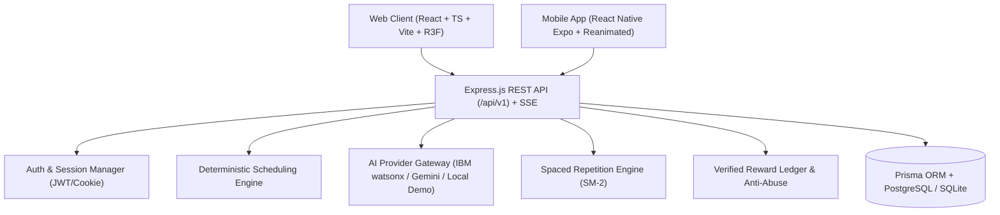

# Product Requirements Document (PRD)
## AI Smart Study Planner

**Version:** 1.0.0  
**Status:** Approved for Implementation  
**Target Delivery:** Q4 2026 / Academic Year 2026–2027  
**Author:** Principal Product Architecture Team

---

## 1. Executive Summary & Vision

University and engineering students face an overwhelming cognitive load: managing 5–7 complex technical subjects simultaneously, balancing impending semester examination deadlines, pacing their daily study sessions, diagnosing gaps in comprehension, and scheduling disciplined spaced revisions. Existing solutions are fragmented—either generic to-do apps without syllabus awareness, static calendar tools that ignore cognitive fatigue, or isolated flashcard utilities disconnected from university syllabi.

**AI Smart Study Planner** is an integrated, adaptive web and mobile learning platform that unifies:
1. **Deterministic Constraint-Based Study Scheduling:** Generates real, conflict-free, day-by-day study sessions based on actual examination dates, syllabus depth, topic difficulty, and student availability.
2. **Context-Aware AI Learning Assistant:** Provides multi-format academic explanations (from 2-mark definitions to 15-mark university exam answers, step-by-step derivations, code implementations, and interactive flashcards) with honest fallback handling.
3. **Adaptive Spaced Repetition (SuperMemo-2 / Leitner Hybrid):** Dynamically reschedules topic reviews based on verified active recall scores.
4. **Verified Gamification & Reward Ledger:** Rewards XP, streaks, and achievements only for verified study time and completed assessments, strictly preventing spam or fake completion.
5. **Three.js Immersive Visualizations:** Features an interactive 3D "Study Universe" graph mapping syllabus mastery, an ambient evolving "Learning Progress Orb", and a focus timer visualizer with low-power 2D fallbacks.

---

## 2. Target User Personas & Core Outcomes

### 2.1 Personas

| Persona | Academic Profile | Core Pain Point | Primary Product Need |
| :--- | :--- | :--- | :--- |
| **Arjun (Engineering Sophomore)** | CS Major, 6 intense subjects (DSA, OS, DBMS, Calculus, Discrete Math, Digital Logic). | Procrastination, cramming 3 days before finals, lack of structured revision. | Automated study schedules with daily achievable quotas, weak-topic warnings, and code/math-capable AI tutoring. |
| **Elena (Pre-Med / Biology)** | High volume of anatomical terminology, biochemistry pathways, and standardized exam deadlines. | Forgetting early units by the time final exams arrive. | Spaced repetition queue with flashcards and adaptive review intervals. |
| **Marcus (Working Student)** | Evening degree program; only 2.5 hours on weekdays and 6 hours on weekends available. | Static calendars that break when unexpected work shifts cause missed sessions. | Real-time adaptive rescheduling and missed-session recovery without overloading future days. |

### 2.2 The 5 Fundamental Questions

At any given moment, the user must be able to answer:
1. **What should I study next?** (Instantly visible on Dashboard as the Primary Action Card).
2. **How much time should I spend on it?** (Clearly bounded session duration with timer and checklist).
3. **Do I understand the topic?** (Confidence rating combined with immediate 5-question micro-quiz).
4. **What should I revise today?** (Dedicated Spaced Repetition queue with due/overdue items).
5. **How prepared am I for my examination?** (Empirical readiness score based on syllabus completion and quiz mastery).

---

## 3. High-Level System Architecture & Cross-Platform Scope

### Key Technical Tenets:
- **Unified Backend:** A single JavaScript/Node.js API service serves both desktop web and native mobile clients.
- **Single Source of Truth:** Business logic, XP rules, and scheduling constraints reside in the shared backend and domain packages.
- **Honest AI Fallback:** When external LLM APIs are unreachable or unconfigured, the system provides a clearly labeled deterministic academic demo tutor with verified domain responses.

---

## 4. Detailed Feature Specifications

### 4.1 Onboarding & Setup Workflow (10-Step Wizard)
1. **Profile Setup:** Name, academic level, daily study goals, and local timezone.
2. **Subject Registration:** Name, code, priority, and distinct accessible color token.
3. **Exam Dates Entry:** Target dates for mid-term, semester finals, or certifications.
4. **Syllabus Hierarchy:** Units, chapters, and topics (supports CSV/JSON bulk import).
5. **Weekly Availability Grid:** Set available study hours per day of the week (e.g., Mon 3h, Tue 2h, Sun 6h) with blocked times.
6. **Session Preferences:** Preferred study block length (e.g., 25 min Pomodoro, 45 min deep work, 60 min block) and break duration.
7. **Initial Confidence Rating:** Self-assessment per topic (1 = Novice, 3 = Moderate, 5 = Confident).
8. **Plan Generation Preview:** Dry-run calculation showing timeline, buffer days, and daily loads.
9. **Plan Confirmation:** Commits generated sessions to the persistent database.
10. **Dashboard Launch:** Transitions to the active dashboard with today's immediate session queued.

### 4.2 Deterministic Study Planner & Rescheduling Engine
- **Capacity Enforcement:** Daily scheduled sessions cannot exceed `user_availability[day_of_week] - blocked_hours`.
- **Constraint Solver:** Topics with high weightage, high difficulty, low confidence, and approaching examination dates receive top priority allocation.
- **Revision Buffer:** Automatically reserves 15–20% of the period prior to an exam for spaced repetition reviews.
- **Adaptive Rescheduling:** If a session is marked `Missed` or `Skipped`, the scheduler redistributes unstudied topics into upcoming available slots without silent daily overloading.

### 4.3 AI Study Assistant & Multi-Format Academic Tutor
- **16 Discrete Output Formats:**
  1. *Explain Concept* (Core conceptual breakdown)
  2. *Simple Explanation* (ELIF / intuition-first with everyday analogies)
  3. *Detailed Academic Treatise* (Rigorous textbook-style explanation)
  4. *Step-by-Step Derivation* (Mathematical and algorithmic steps)
  5. *2-Mark University Exam Answer* (Crisp, high-impact definition)
  6. *5-Mark University Exam Answer* (Definition, 3 key points, diagram description)
  7. *10-Mark University Exam Answer* (Structured comprehensive essay with headers)
  8. *12-Mark University Exam Answer* (Extended analysis, pros/cons, applications)
  9. *15-Mark University Exam Answer* (Complete university thesis with historical context and case study)
  10. *Short Notes & Cheat Sheet* (High-yield bullet points)
  11. *Bullet Points* (Concise factual summary)
  12. *Comparative Table* (Markdown matrix comparing concepts or algorithms)
  13. *Code Implementation & Walkthrough* (Clean code with time/space complexity analysis)
  14. *Mathematical Proof* (Formal notation and axiomatic derivation)
  15. *Flashcard Deck* (Front/Back Q&A pairs for active recall)
  16. *Interactive Quiz* (JSON-formatted MCQ and short-answer questions)
- **Streaming UI:** Real-time Server-Sent Events (SSE) streaming with cancellation and retry controls.
- **Context Injection:** Assistant automatically injects topic title, unit, subject, and student confidence into prompt context.

### 4.4 Spaced Repetition (SRS) Engine
- Implements an optimized SM-2 algorithm:
  $$I(1) = 1, \quad I(2) = 6, \quad I(n) = I(n-1) \times EF$$
  $$EF' = EF + (0.1 - (5 - q) \times (0.08 + (5 - q) \times 0.02))$$
  where $q \in \{1: \text{Again}, 2: \text{Hard}, 3: \text{Good}, 4: \text{Easy}\}$, and $EF \ge 1.3$.
- Four user actions during review: `Again (Fail)`, `Hard`, `Good`, `Easy`.
- Organizes reviews into **Due Today**, **Overdue**, and **Upcoming 7 Days**.

### 4.5 Verified Productivity Rewards & Gamification
- **Zero-Trust Reward Ledger:** XP is awarded solely upon server-side validation of completed sessions (minimum duration elapsed) and validated quiz submissions.
- **Idempotency:** Every reward transaction stores a unique idempotency key (`source_event_id + event_type`) preventing duplicate reward exploits.
- **Progression Hierarchy:**
  - Level 1: *Beginner Scholar* (0–200 XP)
  - Level 2: *Consistent Learner* (201–600 XP)
  - Level 3: *Focused Scholar* (601–1,400 XP)
  - Level 4: *Knowledge Builder* (1,401–3,000 XP)
  - Level 5: *Master Scholar* (3,001+ XP)
- **Streak Calculation:** Evaluated against the user's declared local timezone (UTC offset); requires at least one completed session or revision review per calendar date. Supports a weekend rest-day policy.

### 4.6 3D Immersive Learning Experiences (Three.js / React Three Fiber)
1. **Study Universe:** A 3D planetary system representing subjects as planetary cores and topics as orbiting moons. Color-coded by mastery:
   - Red/Amber: Needs Attention / Low Mastery
   - Olive/Cyan: In Progress
   - Emerald: Mastered
2. **Learning Progress Orb:** A reactive 3D sphere rendered on the dashboard and rewards screen with surface perturbation and shader glow linked to current student XP and streak state.
3. **Ambient Focus Mode:** Distraction-free full-screen study environment with subtle particle drift.
4. **Performance & Accessibility:** Automatically detects low-power hardware, battery saver mode, or `prefers-reduced-motion` to fall back to optimized 2D canvas/SVG representations.

---

## 5. Non-Functional Requirements (NFRs)

- **Performance:** 
  - First Contentful Paint (FCP) < 1.2s on desktop, < 1.8s on mobile 4G.
  - Three.js render loop throttles to 30fps on battery or pauses completely when the tab or window is unfocused.
- **Accessibility:** Full WCAG 2.2 Level AA compliance, semantic HTML, visible keyboard focus rings (3px olive/accent), and screen-reader accessible ARIA live regions.
- **Security:** Argon2/bcrypt password hashing, HTTP-only SameSite secure JWT cookies, parameterized Prisma queries (SQL injection immune), and strict DOMPurify sanitization for AI Markdown rendering.
- **Reliability:** 100% offline-safe read capability for cached study agendas and notes on mobile.

---

## 6. Success Metrics & Release Criteria
- **Scheduling Accuracy:** 0 overlapping sessions generated across all test test-cases.
- **Reward Integrity:** 0 instances of duplicate XP awarded for replayed requests.
- **AI Streaming Stability:** SSE reconnects gracefully within 3 attempts upon network blip.
- **Cross-Platform Parity:** 100% data and state synchronization between web and mobile clients via unified REST endpoints.
