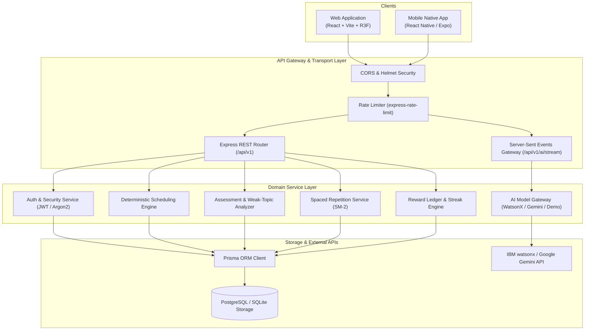
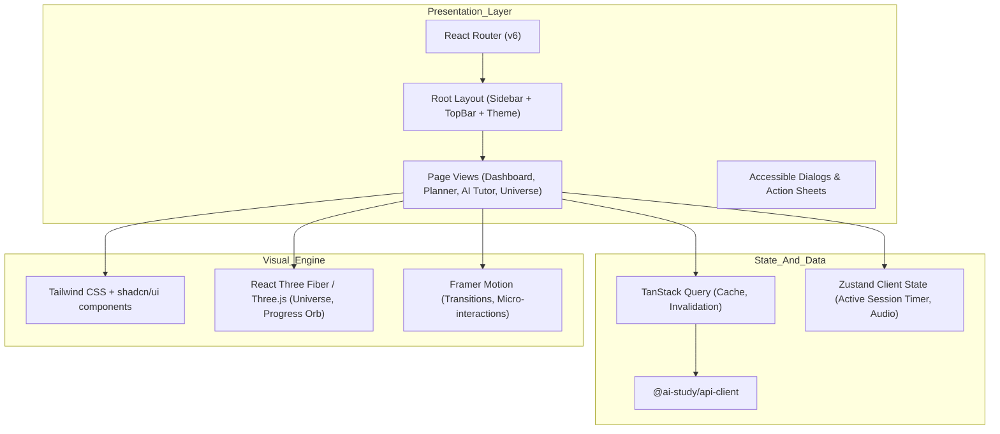
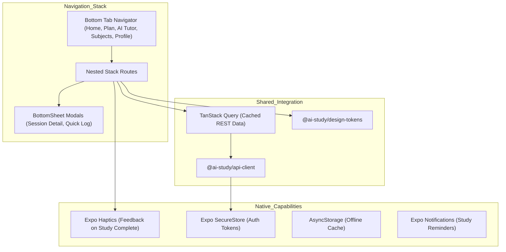
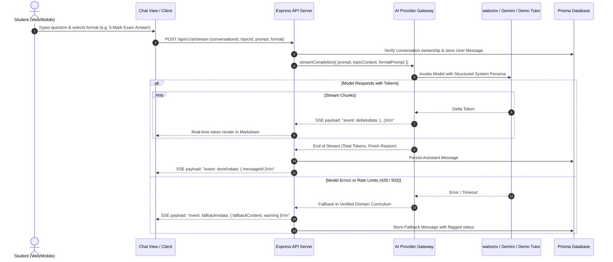
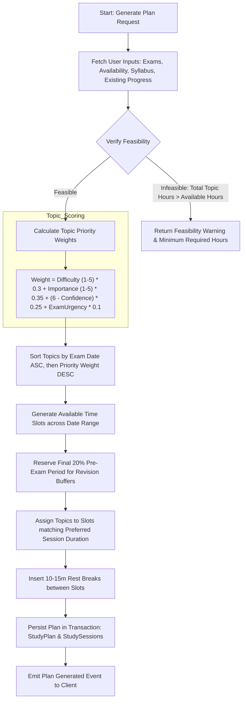
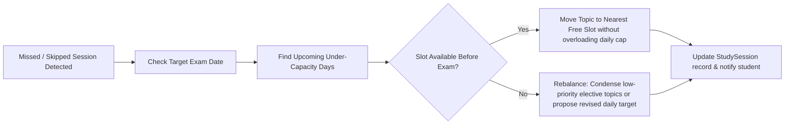
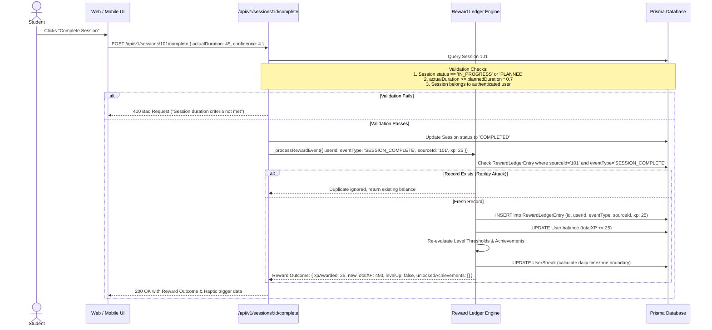
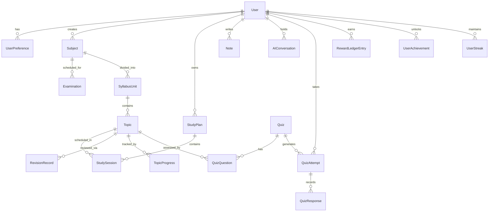

# System Architecture & Technical Design
## AI Smart Study Planner

**Version:** 1.0.0  
**Status:** Approved  
**Language/Runtime:** Node.js (JavaScript ES Modules) / React (TypeScript) / React Native (Expo)

---

## 1. System Context & Monorepo Layout

The AI Smart Study Planner is structured as an enterprise-grade monorepo containing three core applications and four shared packages. This guarantees shared typing, unified validation rules, and cohesive business domain logic across web and native mobile clients.

```text
ai-smart-study-planner/
├── apps/
│   ├── web/                     # React 18 + Vite + Tailwind CSS + shadcn/ui + Three.js/R3F
│   ├── mobile/                  # React Native + Expo Router + TypeScript + Reanimated
│   └── api/                     # Node.js (ESM) + Express + Prisma ORM + SSE + Pino
├── packages/
│   ├── shared-schemas/          # Zod request/response validation schemas & TypeScript types
│   ├── design-tokens/           # Design system tokens (colors, typography, spacing, themes)
│   ├── domain/                  # Pure deterministic algorithms (Scheduling, SM-2, XP, Streaks)
│   └── api-client/              # Universal isomorphic typed HTTP/SSE API client
├── docs/                        # Complete technical specifications
├── design/                      # UI/UX design specifications
├── package.json                 # Monorepo workspace configuration
├── .env.example
└── README.md
```

### High-Level System Context Diagram



---

## 2. Web Frontend Architecture (`apps/web`)

The web frontend is built with modern React 18, Vite, TypeScript, and a bespoke design system inspired by Linear and Notion.



---

## 3. Mobile Native Architecture (`apps/mobile`)

The mobile client is built on React Native with Expo and Expo Router, engineered for native tactile interactions, safe-area adaptation, and offline-resilient access.



---

## 4. AI Question & Streaming Lifecycle

The AI subsystem guarantees transparent, failure-resilient communication with language models.



---

## 5. Study-Plan Generation Pipeline

The deterministic study-plan generation pipeline executes in four disciplined phases:



---

## 6. Adaptive Rescheduling & Missed-Session Recovery

When a student misses a planned session, the system prevents silent backlog accumulation:



---

## 7. Verified Reward Event Processing & Anti-Abuse Architecture

To ensure game mechanics foster genuine productivity rather than dopamine-chasing exploits, all XP, levels, and streaks are backed by an immutable ledger:



---

## 8. Database Entity Relationships Overview

The schema is normalized to ensure data integrity, cascade deletion safety, and fast query indexing across user workspaces.


