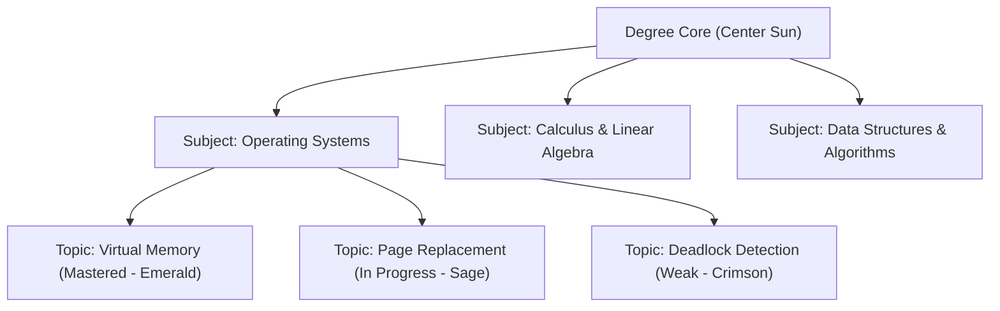

# Three.js & Immersive 3D Experiences
## AI Smart Study Planner

**Version:** 1.0.0  
**Libraries:** Three.js / `@react-three/fiber` / `@react-three/drei`  
**Web Support:** Full WebGL 2.0 with dynamic 2D canvas/SVG fallbacks  
**Mobile Strategy:** Lightweight 2D canvas/SVG to preserve battery life and prevent thermal throttling

---

## 1. 3D Study Universe (Interactive Syllabus Topology)

The **Study Universe** provides an intuitive spatial representation of the student's academic degree, transforming an abstract checklist of 100+ topics into a celestial solar system.



### 1.1 Shader & Material Specifications
- **Planetary Surface:** Custom shader material combining Fresnel rim lighting and noise-based surface texture tinted by `subject.colorToken`.
- **Mastery Aura:** Outer glow mesh with emissive intensity proportional to `topic.masteryScore`:
  - `Mastered (>= 85%)`: `#4CAF50` (Emerald Green, subtle pulse)
  - `Proficient (70-84%)`: `#5B8C51` (Muted Sage)
  - `Needs Attention (< 50%)`: `#E0524C` (Soft Crimson alert)

### 1.2 User Interactions
- **OrbitControls:** Constrained camera orbit (min distance 5 units, max distance 40 units; polar angle clamped to $[0.2, \pi - 0.2]$ to prevent camera flip).
- **Raycasting Click:** Clicking a topic node smoothly flies the camera to the node via exponential dampening and opens the Topic Quick Drawer (Study Session launcher, AI Tutor query, or Quiz prompt).

---

## 2. 3D Learning Progress Orb

Rendered in the top right of the Web Dashboard and Gamification screen:
- A compact $120 \times 120\text{ px}$ canvas rendering a morphing, fluidic icosahedron.
- Vertex deformation driven by Perlin noise in a vertex shader:
  ```glsl
  vec3 pos = position + normal * (sin(time * 2.0 + position.y * 3.0) * 0.1 * intensity);
  ```
- Color transitions gracefully between theme modes: Warm Forest Green in light mode, Luminous Sage in dark mode.

---

## 3. Ambient Focus Environment

An optional full-screen 3D focus view activated during timed study sessions:
- Displays 250 gently drifting instanced dust particles (`InstancedMesh`) moving along a subtle vector field.
- Visual cadence: $0.2\text{ rad/sec}$ drift rate, creating a calming academic atmosphere without drawing eye focus away from notes.
- Includes a 1-click button: *"Distraction-Free 2D View"* that unmounts the canvas and renders a clean minimalist timer.

---

## 4. Performance, Lifecycle & Fallback Architecture

### 4.1 Strict Memory Management & Disposal
To prevent WebGL memory leaks during single-page application navigation:
```typescript
useEffect(() => {
  return () => {
    // Explicitly traverse scene and dispose GPU buffers
    scene.traverse((object) => {
      if (object instanceof THREE.Mesh) {
        object.geometry?.dispose();
        if (Array.isArray(object.material)) {
          object.material.forEach((mat) => mat.dispose());
        } else {
          object.material?.dispose();
        }
      }
    });
    renderer.dispose();
  };
}, []);
```

### 4.2 WebGL Context Loss & Battery Optimization
1. **Background Throttling:** When `document.hidden` is true, the `requestAnimationFrame` loop suspends rendering entirely ($0\text{ fps}$).
2. **Context Loss Handler:** Listens for `webglcontextlost` event:
   ```typescript
   gl.canvas.addEventListener('webglcontextlost', (e) => {
     e.preventDefault();
     setHasWebGLError(true);
   });
   ```
3. **Graceful 2D Fallback:** If WebGL 2.0 is disabled, hardware acceleration is unsupported, or `prefers-reduced-motion` is active, the app automatically mounts an interactive 2D SVG Node Graph component providing identical data inspection and click-through functionality.
